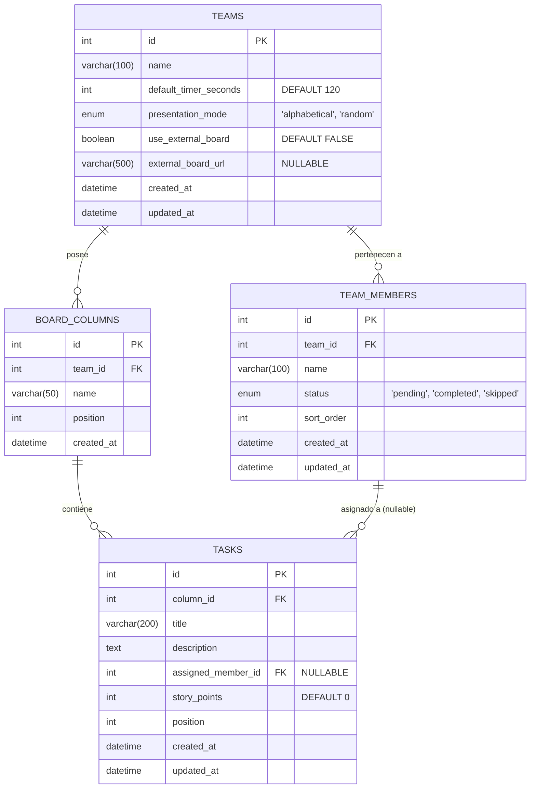

# Documento de Arquitectura de Software: Scrum Meeting Board

**Versión:** 2.0.0  
**Fecha:** Noviembre 2026  
**Rol:** Arquitecto de Software Senior  
**Estado:** Aprobado para Construcción  
**Objetivo de Plataforma:** Vista única de escritorio (Desktop Web App para Google Chrome y Apple Safari en macOS y Windows. Sin diseño móvil).

---

## 1. Visión General del Sistema

**Scrum Meeting Board** es una aplicación web de escritorio especializada en la gestión y facilitación de reuniones de Scrum (Daily Standups, Refinamiento y Sprint Planning) para equipos ágiles. La experiencia de usuario está optimizada para pantallas grandes, salas de conferencia y sesiones de pantalla compartida.

### 1.1 Objetivos Clave
- **Control Estricto de Tiempos por Turno:** Cronómetro por integrante con semáforo cromático dinámico y persistencia por equipo.
- **Flujo de Turnos Automatizado y Flexible:** Gestión de turnos con estados visuales (Reloj/Pendiente, Check verde/Completado, X roja/Omitido) y ordenamiento configurable (Alfabético o Aleatorio).
- **Tablero Scrum Nativo vs. Board Externo:** Capacidad de alternar entre un tablero de tareas Drag & Drop local y enlaces directos a tableros corporativos externos (Jira, Miro, Azure DevOps).
- **Persistencia Relacional Transaccional:** Almacenamiento en MySQL 8.0 vía Connection Pool (`mysql2/promise`).
- **Testabilidad E2E Robusta con Playwright + Java:** Convención exhaustiva y obligatoria de selectores `data-testid` que garantizan automatización sin fragilidad visual ni dependencias de clases CSS.

---

## 2. Diagrama de Arquitectura del Sistema

```text
+--------------------------------------------------------------------------------------------------------+
|                                    NAVEGADOR DE ESCRITORIO (Mac / Windows)                             |
|                                       Google Chrome 120+ / Safari 17+                                  |
|                                                                                                        |
|  +--------------------------------------------------------------------------------------------------+  |
|  |                                  SINGLE VIEW LAYOUT (React + Vite)                               |  |
|  |                                                                                                  |  |
|  |  +--------------------------------------------------------------------------------------------+  |  |
|  |  |                                   HEADER (20% Alto)                                        |  |  |
|  |  |   [Mitad Izq: Nombre Team (Right-click: Edit)]     [Mitad Der: Cronómetro editable (Color)]    |  |  |
|  |  |   [Botón: Agregar Team]                            [Botones: Play/Pausa | Skip]               |  |  |
|  |  +--------------------------------------------------------------------------------------------+  |  |
|  |  |                               PANEL INFERIOR (80% Alto)                                    |  |  |
|  |  |  +---------------------------------------+-----------------------------------------------+  |  |
|  |  |  |    PANEL IZQUIERDO (20% Ancho)        |          PANEL CENTRAL (80% Ancho)           |  |  |
|  |  |  |  - Selectores: Modo / Team            |  - Checkbox: "Usar Board externo"            |  |  |
|  |  |  |  - Lista Miembros (Icono + Turno)    |  - Vista A: Enlace Board externo             |  |  |
|  |  |  |    (Right-click: Restablecer/Edit/Del)|  - Vista B: Tablero Scrum Drag & Drop         |  |  |
|  |  |  |  - Opciones: +Miembro, Reset, Random  |             (Columnas + Fichas)               |  |  |
|  |  |  +---------------------------------------+-----------------------------------------------+  |  |
|  +--------------------------------------------------------------------------------------------------+  |
+---------------------------------------------------+----------------------------------------------------+
                                                    |
                                                    | HTTP REST / JSON (CORS)
                                                    v
+--------------------------------------------------------------------------------------------------------+
|                                  BACKEND API (Node.js + Express)                                       |
|                                                                                                        |
|  - Middleware: CORS, Morgan, express.json(), Centralized Error Handler                                 |
|  - Routers:                                                                                            |
|      /api/teams          -> CRUD Teams, auto-creación de columnas por defecto, configuración           |
|      /api/members        -> Gestión de miembros, estados ('pending','completed','skipped'), shuffle  |
|      /api/columns        -> Gestión de columnas por equipo                                             |
|      /api/tasks          -> CRUD tareas y reordenamiento atómico Drag & Drop (transacciones)           |
|  - Driver: mysql2/promise (Connection Pool)                                                           |
+---------------------------------------------------+----------------------------------------------------+
                                                    |
                                                    | TCP / Port 3306 (Connection Pool)
                                                    v
+--------------------------------------------------------------------------------------------------------+
|                                    BASE DE DATOS (Docker Container)                                    |
|                                                                                                        |
|  - Motor: MySQL 8.0 Community Server (Docker Compose)                                                  |
|  - Esquema: teams, team_members, board_columns, tasks                                                  |
|  - Charset: utf8mb4_unicode_ci                                                                         |
|  - Persistencia: Volumen nombrado mysql_data                                                           |
+--------------------------------------------------------------------------------------------------------+
```

---

## 3. Modelo Entidad-Relación (DER) y Diccionario de Datos

### 3.1 Diagrama Entidad-Relación (Mermaid)



### 3.2 Especificación de Tablas

#### Tabla: `teams`
| Campo | Tipo | Nulo | Por Defecto | Descripción |
|---|---|---|---|---|
| `id` | INT AUTO_INCREMENT | NO | PK | Identificador único del equipo |
| `name` | VARCHAR(100) | NO | - | Nombre del equipo |
| `default_timer_seconds` | INT | NO | 120 | Duración del cronómetro por turno en segundos |
| `presentation_mode` | ENUM('alphabetical','random') | NO | 'alphabetical' | Modo de ordenamiento de los miembros |
| `use_external_board` | BOOLEAN | NO | FALSE | Bandera para usar URL externa en lugar del Scrum Board nativo |
| `external_board_url` | VARCHAR(500) | SÍ | NULL | Enlace al tablero externo (Jira, Miro, etc.) |
| `created_at` | DATETIME | NO | CURRENT_TIMESTAMP | Fecha de creación |
| `updated_at` | DATETIME | NO | CURRENT_TIMESTAMP ON UPDATE | Última modificación |

#### Tabla: `team_members`
| Campo | Tipo | Nulo | Por Defecto | Descripción |
|---|---|---|---|---|
| `id` | INT AUTO_INCREMENT | NO | PK | Identificador único del miembro |
| `team_id` | INT | NO | FK | Referencia a `teams(id)` ON DELETE CASCADE |
| `name` | VARCHAR(100) | NO | - | Nombre del integrante |
| `status` | ENUM('pending','completed','skipped') | NO | 'pending' | Estado del turno en la reunión |
| `sort_order` | INT | NO | 0 | Orden secuencial en la lista de turnos |
| `created_at` | DATETIME | NO | CURRENT_TIMESTAMP | Fecha de creación |
| `updated_at` | DATETIME | NO | CURRENT_TIMESTAMP ON UPDATE | Última modificación |

#### Tabla: `board_columns`
| Campo | Tipo | Nulo | Por Defecto | Descripción |
|---|---|---|---|---|
| `id` | INT AUTO_INCREMENT | NO | PK | Identificador de columna |
| `team_id` | INT | NO | FK | Referencia a `teams(id)` ON DELETE CASCADE |
| `name` | VARCHAR(50) | NO | - | Nombre visible (ej. To Do, In Progress, Code Review, Done) |
| `position` | INT | NO | 1 | Posición de visualización de izquierda a derecha |
| `created_at` | DATETIME | NO | CURRENT_TIMESTAMP | Fecha de creación |

#### Tabla: `tasks`
| Campo | Tipo | Nulo | Por Defecto | Descripción |
|---|---|---|---|---|
| `id` | INT AUTO_INCREMENT | NO | PK | Identificador de la tarea |
| `column_id` | INT | NO | FK | Referencia a `board_columns(id)` ON DELETE CASCADE |
| `title` | VARCHAR(200) | NO | - | Título de la tarea |
| `description` | TEXT | SÍ | NULL | Descripción detallada |
| `assigned_member_id` | INT | SÍ | FK | Referencia a `team_members(id)` ON DELETE SET NULL |
| `story_points` | INT | NO | 0 | Puntuación de esfuerzo |
| `position` | INT | NO | 0 | Posición relativa de orden dentro de la columna |
| `created_at` | DATETIME | NO | CURRENT_TIMESTAMP | Fecha de creación |
| `updated_at` | DATETIME | NO | CURRENT_TIMESTAMP ON UPDATE | Última modificación |

---

## 4. Reglas de Negocio y Lógica de Interacción

### 4.1 Header (20% del alto total)
- **Mitad Izquierda:**
  - Muestra el nombre del Team activo.
  - Al hacer **clic derecho sobre el nombre del Team**, se despliega la opción "Editar Nombre", que abre un modal de confirmación Sí/No antes de persistir los cambios.
  - Debajo del nombre se sitúa el botón **"Agregar Team"**, que abre un modal para ingresar el nuevo nombre.
  - *Regla de creación:* Al crear un Team, el backend automáticamente genera sus 4 columnas canónicas (`To Do`, `In Progress`, `Code Review`, `Done`).
- **Mitad Derecha:**
  - **Cronómetro:** Formato `MM:SS`. Al hacer clic o clic derecho, se abre un modal de edición con confirmación Sí/No para fijar nuevos segundos por defecto (persistidos en `teams.default_timer_seconds`).
  - **Semáforo Cromático del Cronómetro:**
    - Del 100% al 76% del tiempo: **Negro** (`text-slate-900` o `#000000`).
    - Del 75% al 11% del tiempo: **Amarillo** (`text-amber-500` o `#EAB308`).
    - Del 10% al 0% del tiempo: **Rojo** (`text-rose-600` o `#DC2626`).
  - **Controles de Reproducción:**
    - Botón **Play / Pausa**: Inicia o detiene la cuenta regresiva.
    - Debajo, botón **Skip**: Salta el turno del miembro actual.

### 4.2 Flujo del Turno y Transición de Estados
- **Al llegar el cronómetro a 00:00:**
  1. El miembro en turno activo pasa de **Reloj** (`status: 'pending'`) a **Check verde** (`status: 'completed'`).
  2. El cronómetro se detiene automáticamente.
  3. El foco del turno se transfiere al siguiente miembro con estado `pending`.
  4. El cronómetro se reinicia al tiempo base (`default_timer_seconds`) y queda pausado en espera de que el facilitador presione **Play**.
- **Al presionar el botón Skip:**
  1. El miembro en turno activo pasa inmediatamente a **X roja** (`status: 'skipped'`).
  2. El turno avanza al siguiente miembro con estado `pending`.
  3. Si existen miembros pendientes: el cronómetro se reinicia al tiempo base esperando **Play**.
  4. Si era el **último miembro pendiente**: el cronómetro NO se reinicia, se detiene en su estado actual y se notifica que la ronda ha finalizado.

### 4.3 Panel Izquierdo (20% del ancho)
- **Selectores de Configuración:**
  - Selector de Modo de Presentación: `Alfabético` / `Random` (sincronizado con `teams.presentation_mode`).
  - Selector de Team (conmuta el equipo activo).
- **Lista de Miembros:**
  - Cada ítem muestra el estado actual mediante icono:
    - `Reloj` (Pendiente)
    - `Check verde` (Completado)
    - `X roja` (Omitido)
  - El miembro con el turno activo cuenta con un **destacado visual de alto contraste** (borde y fondo diferencial).
  - Al hacer **clic derecho** sobre cualquier miembro se abre un menú contextual con:
    1. **Restablecer a Reloj:** Cambia el estado a `pending`. Requiere modal de confirmación Sí/No.
    2. **Editar:** Modifica el nombre del miembro. Requiere modal de confirmación Sí/No.
    3. **Eliminar:** Elimina al miembro. Requiere modal de confirmación Sí/No.
- **Acciones Rápidas (al final del listado en este orden exacto):**
  1. **"Agregar nuevo miembro"**: Abre modal para registrar nombre y agregarlo con estado `pending`.
  2. **"Reiniciar todos a Reloj"**: Pone a todos los miembros del equipo en `pending` (modal Sí/No).
  3. **"Quitar orden actual y ordenar Random"**: Baraja aleatoriamente los `sort_order` de los miembros y actualiza el modo a `random`.

### 4.4 Panel Central (80% del ancho)
- **Checkbox "Usar Board externo":**
  - Checkbox persistente por equipo (`teams.use_external_board`).
  - **Si está marcado (Activado):**
    - Muestra un panel donde configurar/editar la URL del tablero externo (`external_board_url`, ej. Jira, Miro, Trello) con botón "Abrir Tablero Externo" que lo abre en pestaña nueva de escritorio.
  - **Si está desmarcado (Desactivado):**
    - Despliega el **Scrum Board interactivo** con las columnas canónicas del equipo.
    - Fichas de tareas que muestran: Título, Miembro asignado del Team, Descripción y Story Points.
    - Soporte completo de **Drag & Drop** entre columnas y reordenamiento vertical.

---

## 5. Convención Estricta de Atributos `data-testid` (Playwright + Java)

Para asegurar la máxima compatibilidad, estabilidad y facilidad de automatización en suites de prueba con **Playwright en Java**, se adopta un estándar riguroso de atributos `data-testid`. **Ningún selector de prueba debe depender de clases CSS o jerarquías DOM frágiles.**

### 5.1 Header y Cronómetro
| Elemento UI | Atributo `data-testid` | Notas / Formato |
|---|---|---|
| Contenedor Header | `header-container` | Contenedor 20% alto |
| Nombre del Team en Header | `header-team-name` | Permite click derecho |
| Botón Agregar Team | `header-btn-add-team` | Abre modal creación |
| Display del Cronómetro | `timer-display` | Texto `MM:SS` (refleja clase de color) |
| Botón Play / Pausa | `timer-btn-toggle` | Cambia entre Play y Pause |
| Botón Skip | `timer-btn-skip` | Salta al siguiente miembro |

### 5.2 Panel Izquierdo (Miembros y Controles de Turno)
| Elemento UI | Atributo `data-testid` | Notas / Formato |
|---|---|---|
| Contenedor Panel Izquierdo | `left-panel-container` | Contenedor 20% ancho |
| Selector de Team | `team-select-dropdown` | `<select>` con equipos |
| Selector de Modo (Alfabético/Random) | `presentation-mode-select` | `<select>` o toggle buttons |
| Contenedor Lista de Miembros | `member-list-container` | `<ul>` o `<div>` lista |
| Fila de Miembro | `member-item-<id>` | Ejemplo: `member-item-3` |
| Nombre de Miembro | `member-name-<id>` | Texto con el nombre |
| Indicador de Turno Activo | `member-active-indicator-<id>` | Presente solo en el miembro en turno |
| Icono de Estado Reloj | `member-status-clock-<id>` | Estado `pending` |
| Icono de Estado Check Verde | `member-status-check-<id>` | Estado `completed` |
| Icono de Estado X Roja | `member-status-skip-<id>` | Estado `skipped` |
| Menú Contextual de Miembro | `member-context-menu` | Desplegado al click derecho |
| Opción Menú: Restablecer a Reloj | `context-menu-opt-reset` | Opción del menú |
| Opción Menú: Editar | `context-menu-opt-edit` | Opción del menú |
| Opción Menú: Eliminar | `context-menu-opt-delete` | Opción del menú |
| Botón Acción 1: Agregar nuevo miembro | `btn-add-member` | Opción fija 1 al pie |
| Botón Acción 2: Reiniciar todos a Reloj | `btn-reset-all-members` | Opción fija 2 al pie |
| Botón Acción 3: Ordenar Random | `btn-randomize-members` | Opción fija 3 al pie |

### 5.3 Panel Central (Board Externo y Scrum Board)
| Elemento UI | Atributo `data-testid` | Notas / Formato |
|---|---|---|
| Contenedor Panel Central | `center-panel-container` | Contenedor 80% ancho |
| Checkbox Usar Board Externo | `checkbox-external-board` | `<input type="checkbox">` |
| Panel de Board Externo | `external-board-panel` | Visible si checkbox está activo |
| Input URL Board Externo | `input-external-board-url` | Campo de texto de la URL |
| Botón Guardar URL Externa | `btn-save-external-url` | Botón para persistir URL |
| Botón Abrir Board Externo | `btn-open-external-board` | Abre enlace en pestaña nueva |
| Contenedor Scrum Board | `scrum-board-container` | Visible si checkbox está inactivo |
| Botón Crear Nueva Tarea | `btn-create-task` | Abre modal creación de tarea |
| Columna del Tablero | `board-column-<id>` | Identificador de columna |
| Título de Columna | `column-title-<id>` | Texto del título |
| Contador de Tareas de Columna | `column-task-count-<id>` | Número de tareas |
| Zona Drop de Columna | `column-drop-zone-<id>` | Área de drop para DnD |
| Tarjeta de Tarea | `task-card-<id>` | Ficha arrastrable |
| Título de Tarea | `task-title-<id>` | Texto del título |
| Asignado de Tarea | `task-assignee-<id>` | Nombre del miembro asignado |
| Story Points de Tarea | `task-points-<id>` | Puntuación numérica |
| Descripción de Tarea | `task-description-<id>` | Texto de la descripción |
| Botón Editar Tarea | `btn-edit-task-<id>` | Abre modal de edición |
| Botón Eliminar Tarea | `btn-delete-task-<id>` | Elimina la tarea |

### 5.4 Modales de Confirmación y Formularios
| Elemento UI | Atributo `data-testid` | Notas / Formato |
|---|---|---|
| Contenedor de Modal Genérico | `modal-dialog-container` | Backdrop / modal activo |
| Título del Modal | `modal-dialog-title` | Encabezado descriptivo |
| Mensaje del Modal | `modal-dialog-message` | Texto explicativo de la acción |
| Botón Confirmar (Sí) | `modal-btn-confirm` | Acción afirmativa / Guardar |
| Botón Cancelar (No) | `modal-btn-cancel` | Descartar o cancelar |
| Input de Formulario en Modal | `modal-form-input` | Campo de texto principal |
| Input de Segundos de Timer | `modal-timer-seconds-input` | Para edición de cronómetro |

---

## 6. Endpoints de la API REST

| Método | Endpoint | Descripción |
|---|---|---|
| `GET` | `/api/teams` | Lista todos los equipos |
| `GET` | `/api/teams/:id` | Obtiene equipo completo con miembros, columnas y tareas |
| `POST` | `/api/teams` | Crea un equipo y genera sus 4 columnas por defecto |
| `PUT` | `/api/teams/:id` | Actualiza propiedades del equipo (nombre, timer, modo, board externo) |
| `DELETE` | `/api/teams/:id` | Elimina equipo y cascadas |
| `POST` | `/api/teams/:teamId/members` | Agrega un nuevo integrante al equipo |
| `PUT` | `/api/members/:id` | Edita nombre del integrante |
| `DELETE` | `/api/members/:id` | Elimina integrante |
| `PATCH` | `/api/members/:id/status` | Actualiza estado individual (`pending`, `completed`, `skipped`) |
| `POST` | `/api/teams/:teamId/members/reset-status` | Reinicia todos los miembros del equipo a `pending` |
| `POST` | `/api/teams/:teamId/members/reorder` | Reordena miembros (`alphabetical` o `random`) y actualiza `sort_order` |
| `GET` | `/api/teams/:teamId/columns` | Lista columnas de un equipo con sus tareas ordenadas |
| `POST` | `/api/teams/:teamId/columns` | Crea una nueva columna |
| `PUT` | `/api/columns/:id` | Actualiza nombre o posición de columna |
| `DELETE` | `/api/columns/:id` | Elimina una columna |
| `POST` | `/api/tasks` | Crea una nueva tarea |
| `PUT` | `/api/tasks/:id` | Actualiza tarea (título, descripción, asignado, story points) |
| `PATCH` | `/api/tasks/:id/move` | Mueve de columna y reordena posición relativa con transacción SQL |
| `DELETE` | `/api/tasks/:id` | Elimina tarea |
